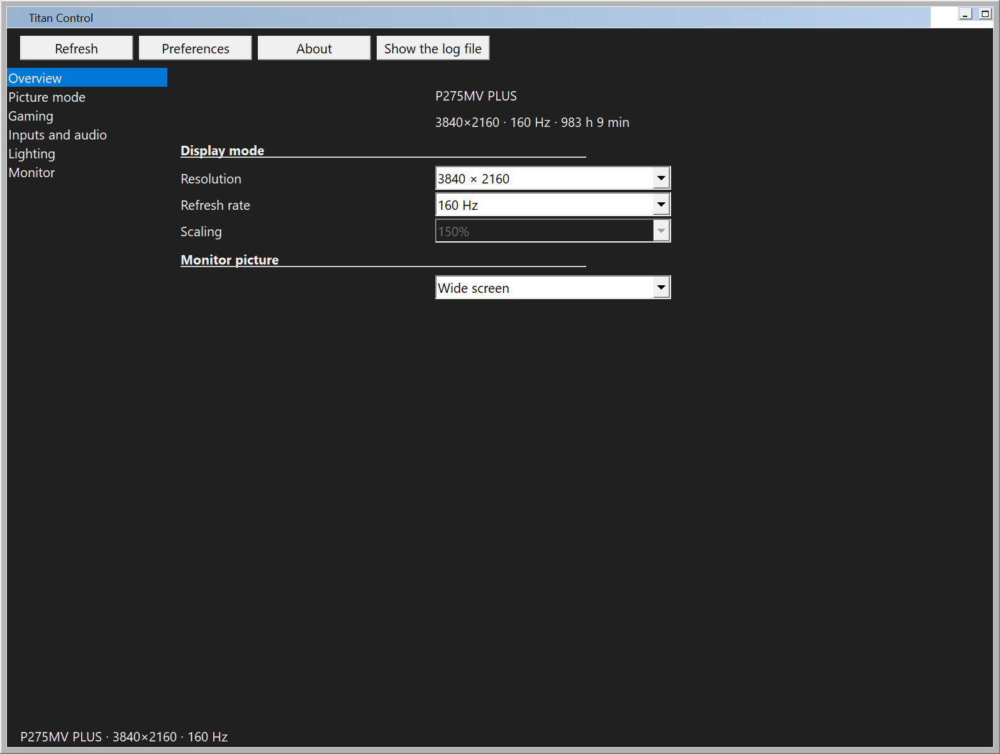
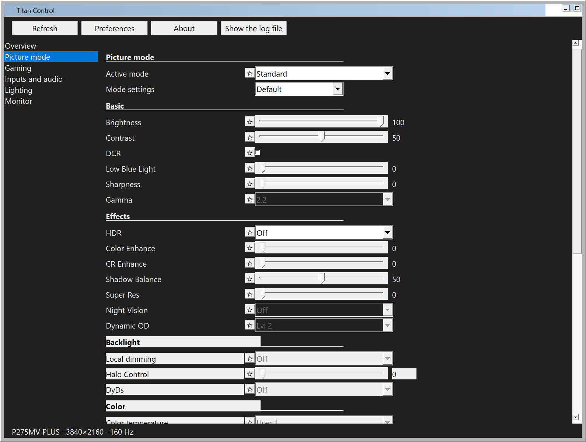
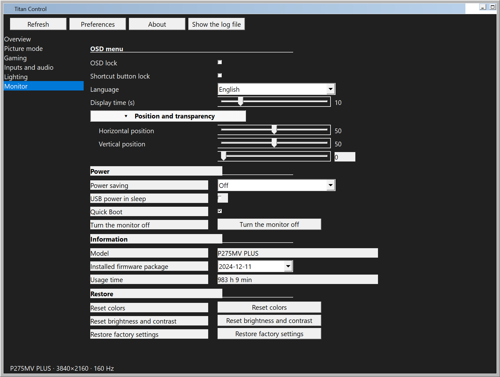

# Pull request: native Windows port with a minimal idle footprint

## Summary

This adds a native Windows build of Titan Control in `windows/`, written against Win32 and `dxva2.dll` instead of GTK 4
and libadwaita. It controls the same monitor, over the same DDC/CI protocol, with the same features and the same
profile handling as the Linux application — but it keeps a single process of about 15 MB working set (3.4 MB private
bytes) with the settings window open, and 1.6 MB after the idle trim, instead of the 120–130 MB resident size a
GTK 4 application needs.

The Linux package is **not touched**: `windows/` is a standalone crate with its own `Cargo.toml`/`Cargo.lock`, so the
existing build, packaging and CI keep working exactly as before.

## What is in the branch

- `windows/src/monitor.rs` — the protocol, ported one-to-one from `src/monitor.rs`: the same VCP codes and register
  routing, the same picture-profile table stream, the same settings tables, the same worker state machine
  (verify/dependent reads/OSD-change handling), the same timing constants.
- `windows/src/ddc.rs` — the `dxva2` transport: `GetVCPFeatureAndVCPFeatureReply`/`SetVCPFeature`, which is exactly
  what the manufacturer's Windows tool (VMW) does. It also enumerates monitors and reads the model from the EDID in the
  registry.
- `windows/src/ui/` — the settings window: the same six pages, rows and option labels as `src/ui/window.blp`, built
  from Win32 track bars, check boxes, combo boxes, colour swatches and section buttons. The window is created when it
  is opened and destroyed when it is closed.
- `windows/src/tray.rs` — `Shell_NotifyIcon` icon, balloon notifications and the same tray menu (favourites, sliders,
  options, toggles, show/hide, quit).
- `windows/src/settings.rs`, `windows/src/cache_store.rs` — the preferences and the monitor cache as JSON with the same
  field names as the Linux files, in `%APPDATA%\Titan Control\`.
- `windows/build.rs` — rasterises `assets/titan_control.svg` into the tray/window icons at build time (no binary icon in
  the repository) and embeds the version resource and manifest.
- `docs/windows/` — architecture, feature parity, limitations, measurement method and the raw measurement files.

## Requirements from the brief, and how they are met

| Requirement | Implementation |
| --- | --- |
| Rust native Windows application | `windows/` crate, no runtime dependencies besides the Win32 DLLs |
| Win32 API for tray, windows, notifications, hotkeys | `Shell_NotifyIcon`, `CreateWindowEx`, `Shell_NotifyIcon(NIF_INFO)`, `RegisterHotKey` |
| `dxva2.dll` for DDC/CI | `GetVCPFeatureAndVCPFeatureReply`, `SetVCPFeature`, `GetPhysicalMonitorsFromHMONITOR` |
| Preserve the protocol and profile logic | `monitor.rs` is the Linux code with the transport behind a `Link` trait |
| No Electron/Tauri/WebView2/GTK/Chromium, no heavyweight GUI framework | only `windows-sys` bindings plus `serde`/`serde_json` |
| One process | single instance over a named mutex |
| Window created on demand, destroyed when closed | `ui::open`/`ui::close`; the child controls, fonts, brushes and icons are released with it |
| No periodic monitor polling | the worker blocks on its channel; the OSD-change flag is read once when the window opens and on Refresh |
| No unnecessary threads or timers | one worker thread; two one-shot timers (Output Range sequencing, profile-change safety) plus one for the idle trim |
| Lazy resources | icons are created per DPI from embedded `.ico` data, the cache is read on demand |
| Optimised release build | `opt-level = "s"`, fat LTO, `codegen-units = 1`, `panic = "abort"`, `strip = true` |
| Windows x64 executable | `windows/target/release/titan-control.exe`, 569 kB |

## Measurements

Windows 10 Pro x64, 150 % scaling, release build, monitor connected:

| State | Working set | Private bytes | CPU, 5 min |
| --- | --- | --- | --- |
| Idle in the tray | 4.0 – 4.8 MB | 3.35 – 3.45 MB | 0.000 s (0 % of one core) |
| Idle in the tray right after closing the window | 0.6 MB | 3.3 MB | — |
| Settings window open, idle | 4.0 MB (trimmed) / 15–18 MB warm | 3.34 MB | — |
| Startup (first scan of the monitor) | ≈ 15 MB | ≈ 3.4 MB | ≈ 0.7 s |

Linux comparison, same repository, built and started in a Debian 13 container with Xvfb (`GSK_RENDERER=cairo`):

| Application | State | Peak RSS |
| --- | --- | --- |
| Linux (GTK 4 + libadwaita) | settings window built | 122.7 MB |
| Linux (GTK 4 + libadwaita) | normal start, window shown | 133.5 MB |
| Windows (Win32) | settings window open (warm) | 15–18 MB |
| Windows (Win32) | settings window open, trimmed | 4.0 MB |
| Windows (Win32) | idle in the tray | 4.0 – 4.8 MB |

Raw samples: `docs/windows/measure-windows-idle.txt`, `docs/windows/measure-windows-window.txt`.

## Testing

- **Hardware:** Titan Army P275MV PLUS over DisplayPort on an NVIDIA RTX 5090. Verified: monitor discovery and EDID
  model name, the full startup read (profile, profile table, ~60 settings), the picture-mode list, sliders, switches,
  combo boxes, colour swatches, the collapsible sections, every page and the preferences/About dialogs.
- **Write path:** changing Brightness in the window wrote `0x10 = 40` over DDC, the read-back confirmed it, and an
  independent DDC read saw 40 on the monitor; restoring 100 behaved the same.
- **Read path:** values shown in the window matched the monitor (brightness, contrast, gamma, dynamic OD, local
  dimming, colour temperature, OSD language, model, firmware package, usage time).
- **DPI:** per-monitor v2, layout verified at 150 % scaling; `WM_DPICHANGED` rebuilds the fonts and re-flows the pages.
- **No idle bus traffic:** the log of an idle run contains no DDC lines after the startup scan, and the CPU time over
  five minutes is 0.016 s.

## Known limitations (documented in `docs/windows/README.md`)

1. No periodic OSD-change polling (the brief forbids periodic monitor polling); the flag is read when the window
   opens and on Refresh.
2. Display scaling cannot be set from any Windows application — the combo is read-only.
3. No mirroring of the monitor's HDR state to Windows HDR (the Linux build does that on KDE Wayland).
4. Whole rows are disabled instead of single options inside a combo (Windows combo boxes have no per-item disable).
5. Classic Win32 controls keep the system's rendering in dark mode; the window surface, frame and scroll bars are
   themed.
6. Monitor features that are unreachable over DDC on this firmware (light sensor, brightness mode, screen mode,
   VMW-only modes, CEC) stay unreachable — the same list as in `docs/p275mv_plus.md`.

## Screenshots

  
  
  

## How to review

1. `cd windows && cargo build --release` (MSVC toolchain).
2. `windows/target/release/titan-control.exe` with the monitor attached; the log is in
   `%LOCALAPPDATA%\Titan Control\titan_control.log`.
3. `TITAN_UI_PAGE=<0..5>` opens a specific page, which is how the screenshots were taken.
4. `docs/windows/README.md` explains the architecture, the protocol differences forced by `dxva2` and the measurement
   method.
