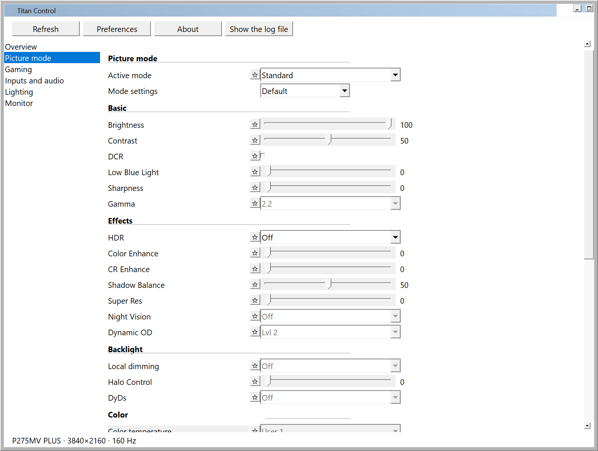
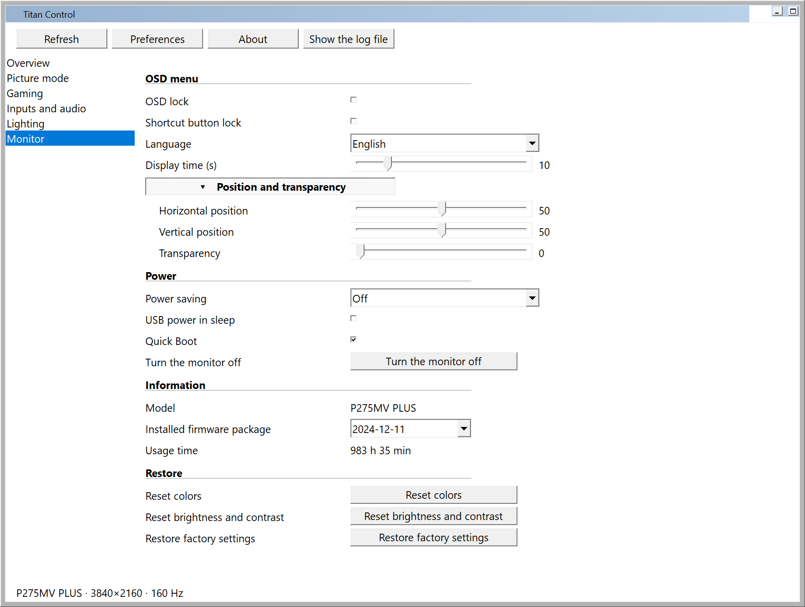
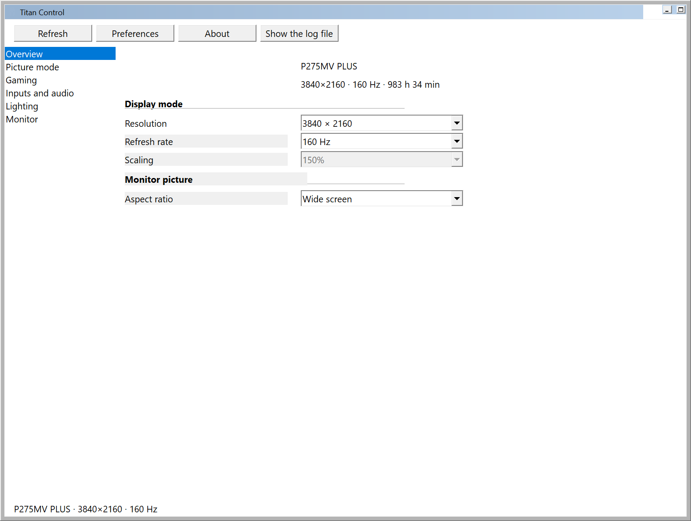

# Titan Control for Windows

A native Windows build of Titan Control: the same monitor control over DDC/CI as the Linux application, written against
Win32 directly instead of GTK 4 and libadwaita, so that it runs in a few megabytes instead of a few hundred.

- **One process, two threads.** The window thread and the DDC/CI worker; nothing else runs while the application sits
  in the notification area.
- **No GUI toolkit.** The settings window is plain Win32 controls (track bars, check boxes, combo boxes, buttons), the
  tray icon is `Shell_NotifyIcon`, the menu is a `CreatePopupMenu` menu.
- **`dxva2.dll` for DDC/CI**, the same calls the manufacturer's own Windows tool (VMW) uses.
- **The window is not kept.** It is created when it is opened and destroyed when it is closed; only the tray icon
  stays.
- **No periodic monitor polling.** Nothing touches the I2C bus unless the user changes something or opens the window.

The Linux package in the repository root is untouched: this build lives in its own crate (`windows/`).

<p align="center">
  
  
</p>

<p align="center"></p>

## Requirements

- Windows 10 or 11, x64.
- Rust with the MSVC toolchain (`rustup default stable-msvc`); the Microsoft C++ build tools provide the linker.

## Build

```powershell
cd windows
cargo build --release
```

The executable is `windows/target/release/titan-control.exe` (about 560 kB). The release profile is tuned for size and
startup cost: `opt-level = "s"`, fat LTO, one codegen unit, `panic = "abort"`, symbols stripped.

The build script (`windows/build.rs`) rasterises `assets/titan_control.svg` into the icon files the tray and the window
use, so the artwork stays in sync with the Linux build, and embeds the executable's version information and manifest
(per-monitor v2 DPI awareness, common controls v6, as-invoker).

## Running

- Start `titan-control.exe`. The settings window opens and the tray icon appears.
- Closing the window keeps the application in the notification area; the tray menu shows or hides it, and `Quit` ends
  the process.
- The tray menu also offers the favourite picture modes, the favourite sliders (as a list of ready values), the
  favourite options and toggles, exactly like the Linux menu.
- **Global hotkeys:** `<favourites key>+Alt+1…5` select the favourite picture modes. The key is chosen in the
  preferences (Ctrl, Shift, Alt or Super; `Ctrl+Alt+1…5` by default).
- **Autostart:** "Start with the system" writes `HKCU\Software\Microsoft\Windows\CurrentVersion\Run`; the entry starts
  the application with `--minimized`, so only the tray icon appears.
- **Single instance:** a named mutex; starting a second copy brings the running window to the front, and
  `titan-control.exe --quit` stops the running instance (handy for scripts and updates).

Paths:

| What | Where |
| --- | --- |
| Preferences | `%APPDATA%\Titan Control\app_settings.json` (same field names as the Linux file) |
| Monitor cache | `%APPDATA%\Titan Control\settings_cache.json` (same layout as the Linux file) |
| Log | `%LOCALAPPDATA%\Titan Control\titan_control.log`, cut at 1 MiB |
| Autostart | `HKCU\Software\Microsoft\Windows\CurrentVersion\Run` value `Titan Control` |

## Architecture

| File | Contents |
| --- | --- |
| `src/main.rs` | entry point, DPI awareness, single instance, message loop, hotkeys, notifications |
| `src/monitor.rs` | the protocol: VCP routing, value tables, profile table stream, worker state machine (port of `src/monitor.rs` of the Linux package) |
| `src/ddc.rs` | the `dxva2` transport and monitor discovery (EDID from the registry, model name) |
| `src/app.rs` | application state, the rules between settings, timers |
| `src/ui/mod.rs` | the settings window: pages, rows, layout, scrolling, dark/light palette |
| `src/ui/rows.rs` | the declarative page and row tables (mirrors `src/ui/window.blp`) |
| `src/ui/prefs.rs` | the preferences and About dialogs |
| `src/tray.rs` | tray icon, balloon notifications, the popup menu |
| `src/settings.rs`, `src/cache_store.rs` | JSON preferences and monitor cache |
| `src/i18n.rs` | translations (Polish sources, English dictionary — the same pair as the Linux UI) |

Threads: the window thread runs the message loop; the worker thread owns the monitor handle and the task queue. The
worker blocks on its command channel and only wakes when a command arrives or a scheduled task (a read-back, a
dependent read) is due — there is no timer that wakes it up on its own.

### Why the protocol lives in `monitor.rs` and not in the transport

The Linux application talks to `/dev/i2c-*` and validates the 11-byte DDC/CI frames itself. `dxva2` instead returns the
decoded maximum/current pair, and it reports a *missing* reply as a successful read of zeros and a stale reply as a
successful read of the previous data. The transport therefore validates what it can (`00/00` is a NULL reply; the
MCCS version must come back for the bus to count as settled) and the protocol above it keeps the Linux rules: 100 ms
between request starts, 324 ms after a failure, `GET 99` must answer `FAFA/FAFA` before a manufacturer read, and the
profile table is only trusted after two identical reads.

Two Windows-specific hardening measures came out of testing against the monitor:

- The profile table stream is restarted from the beginning after any error instead of repeating a single fragment:
  with `dxva2` a lost fragment cannot be told apart from a consumed one (Linux repeats the request on a NULL reply and
  sends `FF` on garbage).
- A Default picture profile is only believed after a second read agrees, because `dxva2` can hand out a stale reply and
  a wrong "Default" would unlock/lock the wrong rows.

## Feature parity with the Linux application

| Feature | Windows |
| --- | --- |
| Overview: model, resolution, refresh rate, usage time | yes |
| Overview: display mode (resolution, refresh rate) | yes, through `ChangeDisplaySettingsExW` |
| Overview: display scaling | shown read-only, see [Limitations](#limitations-and-differences) |
| Overview: aspect ratio | yes |
| Picture mode: all 15 modes, Default/Custom, profile table | yes |
| Picture mode: brightness, contrast, DCR, Low Blue Light, sharpness, gamma | yes |
| Effects: HDR, Color Enhance, CR Enhance, Shadow Balance, Super Res, Night Vision, Dynamic OD | yes |
| Backlight: local dimming, Halo Control, DyDs | yes |
| Color: color temperature, User 1–3 RGB gains, hue, saturation per axis | yes |
| Gaming: Adaptive-Sync, Full Game, overlays (FPS counter, crosshair + shape + color, stopwatch, game time, magnifier, HawkEye, break reminder) | yes |
| Inputs: input source, output range, USB hub, volume, mute | yes |
| PIP/PBP: mode, source, audio source, position, size, swap, reset | yes |
| Lighting: LED on/off, effect, color, strength, front/rear colors, power LED | yes |
| Monitor: OSD lock, button lock, OSD language, display time, position, transparency, power saving, USB power, quick boot, power off, reset colors, reset brightness/contrast, factory reset | yes |
| Information: model, firmware package, usage time | yes |
| Tray: favourites, sliders, options, toggles, show/hide, quit | yes |
| Preferences: language, theme, tray icon style, autostart, start minimized, favourites key | yes |
| Favourite stars next to rows, up to five per group | yes |
| Single instance | yes (named mutex instead of D-Bus) |
| OSD change detection | on window open and on Refresh, see below |

### What the monitor itself supports over DDC

The code-level limits are the same as on Linux and documented in [`docs/p275mv_plus.md`](../p275mv_plus.md): the light
sensor, the "brightness mode", the screen mode registers, the VMW-only modes (DyDs/ULL Pulse, 3D scene, shortcuts) and
CEC cannot be controlled over DDC/CI on this firmware, on any operating system.

## Limitations and differences

These are deliberate, and each one is a Windows constraint or a consequence of the low-idle-resource requirement:

1. **No periodic OSD-change polling.** The Linux application reads the "changed in the OSD" flag every three seconds.
   Windows reads it once when the settings window is opened, and on `Refresh`. Settings changed with the monitor
   buttons while the window is closed therefore appear on the next open — not within three seconds. This is the
   "no periodic monitor polling" requirement; it is also the reason the idle process makes no bus traffic.
2. **Display scaling cannot be set.** Windows has no supported API for changing the per-monitor DPI scaling of another
   monitor; the combo shows the current value and is disabled. (The Linux build only offers this on KDE Wayland and
   COSMIC Wayland.)
3. **No system-HDR mirroring.** On KDE Wayland the Linux build switches the system HDR when the monitor HDR changes.
   The Windows build does not touch Windows' HDR setting; HDR of the monitor works as usual.
4. **Whole-row availability instead of per-option greying.** The Linux UI greys out single options (for example 21:9 in
   the aspect-ratio list, or the first four DyDs modes with Adaptive-Sync on) inside a toggle group. Windows disables
   the row instead; a value the monitor refuses is undone by its read-back (the monitor's own answer is shown).
5. **Halo Control is write-only** (the register does not return the written value). Same as Linux: the slider shows
   the value the application wrote.
6. **The overview page has no monitor picture or wallpaper.** Those were compositor integrations on Linux; the page
   shows the model, resolution, refresh rate and usage time instead.
7. **Themes.** `System` and `Light` use the colours of the standard controls (white window, black text, grey lines), so
   the window, its labels and every control agree and a repaint can never mix two palettes. `Dark` paints the window
   surface and separators dark and asks Windows for the dark caption bar and dark control theme; the classic controls
   keep whatever rendering Windows gives them, because a real dark variant of them is not part of the documented API.
   That is why `System` on a dark Windows still shows a light window: it is the only look in which nothing is
   half-themed. The caption bar follows the Windows light/dark setting for `System` and the chosen value otherwise.
8. **The log file and the configuration live in the Windows paths** listed above instead of the XDG directories.
9. **Notifications use tray balloons** for the errors the Linux splash window showed (for example "monitor not found").

## Memory and CPU

Measured on the development machine (Windows 10 Pro, x64, 150 % scaling) with the release build and the monitor
attached:

| State | Working set | Private bytes | CPU over 5 min |
| --- | --- | --- | --- |
| Idle in the tray, five minutes after the start | 0.19 MB (peak 1.93 MB at the sampling moments) | 2.43 – 2.49 MB | 0.000 s |
| Idle in the tray right after closing the window | 0.6 MB | 3.3 MB | — |
| Settings window open | 1.6 – 20.9 MB, depending on how much of the window was just painted | 3.6 – 4.7 MB | — |
| Startup, first read of the monitor | ≈ 15 MB | ≈ 3.4 MB | 0.7 s for the start-up scan |

"The working set is trimmed once 30 s after the start (and whenever the window is closed): the pages of the window and
of the DLLs that were touched during the start-up scan go back to the system and are faulted in again on demand, so an
idle process holds 4 MB. While the settings window is being painted and scrolled, the working set grows to about
15 MB, most of it shared system pages (`user32`, `gdi32`, `comctl32`, `dwmapi`) that every other application maps as
well; the application's own memory is the 3.3 MB of private bytes.

The exact samples are in [`measure-windows-idle.txt`](measure-windows-idle.txt) and
[`measure-windows-window.txt`](measure-windows-window.txt). The idle run also shows the CPU time: the worker blocks on
its channel, so the process does not wake up between user actions — five minutes of idling cost 0.000 s of CPU and two
threads (the window thread and the worker).

For comparison, the Linux application (GTK 4 + libadwaita) built from this repository and started on the same kind of
machine, measured inside a Debian 13 container with an Xvfb display (`GSK_RENDERER=cairo`):

| Application | State | Peak RSS |
| --- | --- | --- |
| Linux (GTK 4) | settings window built | 122.7 MB |
| Linux (GTK 4) | normal start, window shown, no monitor attached | 133.5 MB |
| Windows (Win32) | settings window open (warm) | 15–18 MB |
| Windows (Win32) | settings window open (after the trim) | 4.0 MB |
| Windows (Win32) | idle in the tray | 4.0 – 4.8 MB |

That is two orders of magnitude less memory than the GTK build (compare the 2.4 MB of private bytes with the 122 MB of
resident memory), and the Windows build is not just smaller but also silent: the idle process makes no bus traffic and
uses no measurable CPU.

The Linux figures were collected with [`linux-baseline.sh`](linux-baseline.sh), which builds the Linux crate and samples
`/proc/<pid>/status` while the application builds its window inside a Debian 13 container with an Xvfb display:

```bash
# inside a Debian 13 container with libgtk-4-dev, libadwaita-1-dev, blueprint-compiler and rustup
./docs/windows/linux-baseline.sh
```

The Windows figures come from [`measure-windows.ps1`](measure-windows.ps1), which samples `Get-Process`
(`WorkingSet64`, `PrivateMemorySize64`, `TotalProcessorTime`) once a minute for five minutes with the window closed and
then with it open:

```powershell
powershell -File docs\windows\measure-windows.ps1
```

## Where the memory goes

- **No toolkit runtime.** GTK 4 + libadwaita alone map tens of megabytes of libraries and set up a compositor session;
  the Windows build links only the Win32 DLLs that are already loaded in every process (`user32`, `gdi32`, `shell32`,
  `dxva2`), plus `windows-sys` bindings that add no runtime.
- **The window is destroyed when it is closed**, together with its icons, fonts, brushes and child controls.
- **The monitor cache is a small JSON file** read on demand; nothing is kept in memory between writes.
- **No idle wakeups.** The worker waits on a channel; the only timers are the two one-shot timers used for the Output
  Range write and the profile-change safety timeout.
- **Small allocations.** Strings are converted to UTF-16 only where a Win32 call needs them, and the settings cache is
  a few kilobytes.

## Development

- `TITAN_UI_PAGE=<0…5>` opens the settings window on another page (used for the screenshots).
- `TITAN_UI_PAGE` and the log file record the window geometry and DPI at creation, which is useful when the layout
  looks wrong on a multi-monitor setup.
- The protocol notes for the monitor are in [`docs/p275mv_plus.md`](../p275mv_plus.md); the hardware tests of the Linux
  crate (`cargo test -- --ignored`) still apply, because the protocol code is the same.
